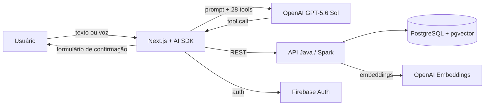

## Financial Controller

Controle financeiro pessoal por conversa. Em vez de preencher formulários, o usuário escreve ou fala em linguagem natural ("gastei 45 no ifood", "quanto gastei com alimentação esse mês?") e um agente de IA transforma o pedido em ações no sistema: lançar transações, consultar gastos, gerar gráficos, gerenciar contas, cartões, categorias e metas.

Projeto desenvolvido na disciplina de Trabalho Interdisciplinar 2 (Ciência da Computação, PUC Minas).

## O que o sistema faz

- **Chat com agente financeiro** que usa 28 ferramentas (tools) sobre os dados do usuário: transações, contas, cartões de crédito, categorias, metas e análises.
- **Confirmação humana antes de gravar**: as ferramentas de criação e edição não salvam nada sozinhas. Elas abrem um formulário pré-preenchido que o usuário revisa, corrige se precisar e confirma.
- **Entrada por voz**: o áudio é transcrito (Whisper) e revisado pelo modelo antes de ir para o chat.
- **Gráficos no chat**: evolução de gastos, receitas e saldo por mês, categoria ou conta.
- **Busca semântica** de transações e metas com embeddings (`text-embedding-3-small`) armazenados no PostgreSQL com `pgvector`.

Fora do escopo hoje: investimentos e integração automática com bancos. O agente informa isso quando perguntado.

## Arquitetura



| Camada | Tecnologias |
|---|---|
| Front-end | Next.js 15, React 19, Vercel AI SDK, Tailwind, shadcn/ui |
| Agente | `src/lib/agent` (prompt e modelo), `src/lib/tools` (uma pasta por domínio) |
| Back-end | Java 17, Spark, HikariCP, Firebase Admin |
| Dados | PostgreSQL (Neon) com `pgvector` |
| Deploy | Vercel (front) e Render (API, via `render.yaml`) |

## Avaliação do agente

Para medir a qualidade do agente de forma objetiva, o projeto tem uma avaliação offline em `Codigo/front-end/eval/`.

**Como funciona:** cada frase do dataset é enviada ao mesmo modelo, prompt e ferramentas usados em produção, mas com a execução das ferramentas desligada. O modelo apenas escolhe a ferramenta e os argumentos, e o script compara com a resposta esperada (ferramenta, tipo, valor, data, categoria etc.). Nada é gravado no banco.

- **Conjunto principal:** 56 frases em português em 7 grupos (lançamentos, consultas, análises, cadastros, edições, pedidos fora do escopo e pedidos ambíguos).
- **Conjunto separado (holdout):** 26 frases com outra escrita (gírias, números por extenso, "R$ 3.250,00"), criado depois dos ajustes e nunca usado para ajustar o prompt.
- As datas esperadas são calculadas a partir do dia da execução, no fuso de São Paulo.

### Resultados

| Conjunto | Antes | Depois |
|---|---|---|
| Principal (56 casos) | 42,9% | 98,8% (166 de 168, em 3 execuções) |
| Holdout (26 casos) | 34,6% | 96,2% |
| Lançamento de transações (principal) | 5% | 96,7% (58 de 60, em 3 execuções) |
| Custo médio por mensagem | US$ 0,0057 | US$ 0,0035 |

As duas falhas restantes no conjunto principal são o mesmo caso: para "recebi 1200 de um freela" o agente sugere a categoria "Freelance", que o critério da avaliação não aceitava. O critério não foi alterado depois de ver o resultado. Os arquivos de cada execução estão em `eval/results/`.

### O que a avaliação revelou

1. **O agente não sabia a data de hoje.** Ele perguntava "qual data você considera como hoje?" ou chutava o ano errado. Correção: a data atual (fuso de São Paulo) passou a ir no prompt, e os exemplos com datas fixas de 2024 foram trocados por regras relativas.
2. **O agente pedia esclarecimento demais.** Em 19 de 20 lançamentos ele perguntava "cartão ou conta?" em vez de agir, porque o próprio prompt usava isso como exemplo de ambiguidade. Como as ferramentas já abrem um formulário de confirmação, o prompt passou a mandar preencher o formulário com a melhor interpretação e só perguntar quando falta o essencial.
3. **Bug de fuso horário fora da IA.** A data de "hoje" era calculada em UTC; depois das 21h no Brasil, transações eram lançadas no dia seguinte. Corrigido e coberto por teste.
4. **Escopo desalinhado.** O prompt prometia investimentos (sem nenhuma ferramenta) e não mencionava metas (que têm cinco ferramentas).

**Limitações conhecidas:** cada conjunto foi executado poucas vezes por limite de custo, então os números têm variação; a avaliação verifica a escolha da ferramenta e dos argumentos, não o texto final da resposta; no holdout, "gráfico do saldo nos últimos meses" ainda gera uma pergunta de esclarecimento.

### Como rodar

```bash
cd Codigo/front-end
bun install
bun test                                   # testes unitários
bun run eval -- --label minha-rodada       # avaliação (precisa de OPENAI_API_KEY no .env.local)
bun run eval -- --dataset holdout --rpm 3 --budget 0.5
```

Opções: `--runs N` repete cada caso, `--tag create_item` filtra um grupo, `--budget` limita o gasto estimado em dólares e `--rpm` respeita o limite de requisições por minuto da conta. Os resultados ficam em `eval/results/`.

## Como executar o projeto

**Back-end** (`Codigo/back-end`): copie `.env.example` para `.env`, preencha `DB_URL`, as credenciais do Firebase e `OPENAI_API_KEY`, aplique `database/schema.sql` e rode `docker compose up` ou `mvn package && java -jar target/*.jar`.

**Front-end** (`Codigo/front-end`): copie `.env.example` para `.env.local`, preencha `NEXT_PUBLIC_API_URL`, as chaves do Firebase e `OPENAI_API_KEY`, e rode `bun install && bun dev`.

## Alunos integrantes da equipe

* Arthur Mendes Lima
* Heitor Lima Moreira
* Matheus Procópio Duarte
* Nicolas Alexandre Torres Dias

## Professores responsáveis

* Wladmir Cardoso Brandao
* Carolina Stephanie Jerônimo de Almeida
