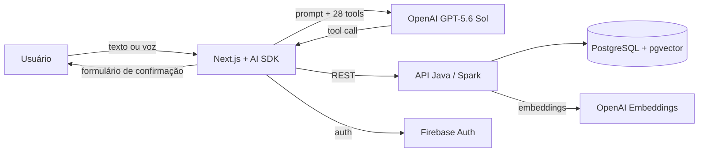

## Financial Controller

Controle financeiro pessoal por conversa. Em vez de preencher formulários, o usuário escreve ou fala em linguagem natural ("gastei 45 no ifood", "quanto gastei com alimentação esse mês?") e um agente de IA transforma o pedido em ações no sistema: lançar transações, consultar gastos, gerar gráficos, gerenciar contas, cartões, categorias e metas.

Projeto desenvolvido na disciplina de Trabalho Interdisciplinar 2 (Ciência da Computação, PUC Minas).

## O que o sistema faz

- **Chat com agente financeiro** que usa 28 ferramentas (tools) sobre os dados do usuário: transações, contas, cartões de crédito, categorias, metas e análises.
- **Confirmação humana antes de gravar**: as ferramentas de criação e edição não salvam nada sozinhas. Elas abrem um formulário pré-preenchido que o usuário revisa, corrige se precisar e confirma.
- **Entrada por voz**: o áudio é transcrito (Whisper) e revisado pelo modelo antes de ir para o chat.
- **Gráficos no chat**: evolução de gastos, receitas e saldo por mês, categoria ou conta.
- **Busca semântica** de transações e metas com embeddings (`text-embedding-3-small`) armazenados no PostgreSQL com `pgvector`.

Fora do escopo hoje: investimentos e integração automática com bancos. O agente informa isso quando perguntado.

## Arquitetura

| Camada | Tecnologias |
|---|---|
| Front-end | Next.js 15, React 19, Vercel AI SDK, Tailwind, shadcn/ui |
| Agente | `src/lib/agent` (prompt e modelo), `src/lib/tools` (uma pasta por domínio) |
| Back-end | Java 17, Spark, HikariCP, Firebase Admin |
| Dados | PostgreSQL (Neon) com `pgvector` |
| Deploy | Vercel (front) e Render (API, via `render.yaml`) |

## Como executar o projeto

**Back-end** (`Codigo/back-end`): copie `.env.example` para `.env`, preencha `DB_URL`, as credenciais do Firebase e `OPENAI_API_KEY`, aplique `database/schema.sql` e rode `docker compose up` ou `mvn package && java -jar target/*.jar`.

**Front-end** (`Codigo/front-end`): copie `.env.example` para `.env.local`, preencha `NEXT_PUBLIC_API_URL`, as chaves do Firebase e `OPENAI_API_KEY`, e rode `bun install && bun dev`.

## Alunos integrantes da equipe

* Arthur Mendes Lima
* Heitor Lima Moreira
* Matheus Procópio Duarte
* Nicolas Alexandre Torres Dias

## Professores responsáveis

* Wladmir Cardoso Brandao
* Carolina Stephanie Jerônimo de Almeida
