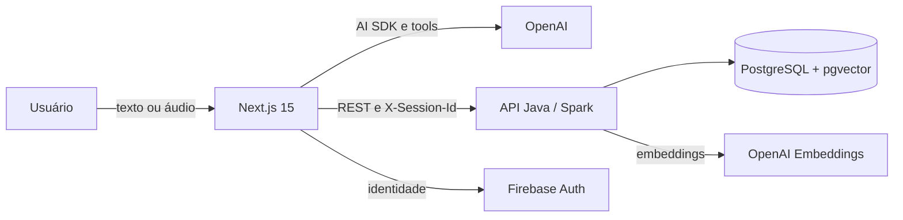

# Financial Controller

Assistente web de finanças pessoais orientado por conversa. O usuário descreve uma movimentação ou faz uma pergunta em linguagem natural, e o agente transforma a solicitação em consultas, análises ou formulários de confirmação.

Projeto desenvolvido na disciplina de Trabalho Interdisciplinar 2 do curso de Ciência da Computação da PUC Minas.

## Funcionalidades

- autenticação com Firebase (e-mail/senha e Google) e sessões persistidas no PostgreSQL;
- conversas com histórico por usuário;
- cadastro, consulta, edição e exclusão de contas, categorias, lançamentos e metas financeiras;
- registro de receitas e despesas com revisão humana antes da gravação;
- filtros e busca semântica em contas, categorias, lançamentos e metas;
- análises de receitas, despesas e saldo, apresentadas com gráficos no chat;
- entrada por voz com transcrição e revisão do texto;
- interface responsiva para desktop e dispositivos móveis.

> Cartões de crédito aparecem como ferramentas experimentais na interface do agente, mas ainda não possuem persistência no back-end. Investimentos e integração bancária automática não fazem parte do escopo atual.

## Arquitetura



| Camada | Tecnologias principais |
| --- | --- |
| Front-end | Next.js 15, React 19, TypeScript, Tailwind CSS, shadcn/ui, AI SDK |
| Agente | OpenAI `gpt-5.6-sol`, tools tipadas com Zod e respostas generativas |
| Back-end | Java 17, Spark Java, HikariCP, Firebase Admin SDK |
| Dados | PostgreSQL com pgvector e embeddings `text-embedding-3-small` |
| Infraestrutura | Docker Compose, Vercel, Render e Neon |

## Estrutura do repositório

```text
.
├── Codigo/
│   ├── back-end/       # API REST, schema e configuração Docker
│   └── front-end/      # aplicação Next.js e agente financeiro
├── Artefatos/          # modelos e diagramas do banco de dados
├── Documentacao/       # visão funcional e técnica do projeto
├── Divulgacao/         # apresentações e materiais de divulgação
└── render.yaml         # blueprint de deploy da API no Render
```

## Execução local

### Pré-requisitos

- Docker com Docker Compose; ou Java 17 e Maven 3.9+;
- Bun (recomendado) ou Node.js 20+;
- projeto Firebase com autenticação configurada;
- chave da OpenAI.

### 1. Back-end e banco de dados

```bash
cd Codigo/back-end
cp .env.example .env
# preencha as credenciais no arquivo .env
docker compose --profile local-db up --build
```

O perfil `local-db` inicia a API na porta `8080` e um PostgreSQL com pgvector, aplicando `database/schema.sql` na primeira criação do volume.

Para conferir a API:

```bash
curl http://localhost:8080/health
```

Resposta esperada: `{"status":"ok"}`.

### 2. Front-end

Em outro terminal:

```bash
cd Codigo/front-end
cp .env.example .env.local
# preencha as credenciais no arquivo .env.local
bun install
bun dev
```

A aplicação fica disponível em [http://localhost:3000](http://localhost:3000).

As instruções para banco externo, execução sem Docker e deploy estão em [Codigo/README.md](Codigo/README.md). As variáveis aceitas estão documentadas nos arquivos `.env.example` de cada aplicação.

## Qualidade e validação

No front-end:

```bash
cd Codigo/front-end
bun test
bun run lint
bun run build
```

No back-end não há suíte automatizada no momento. Para validar a compilação:

```bash
cd Codigo/back-end
mvn clean package
```

## Equipe

- Arthur Mendes Lima
- Heitor Lima Moreira
- Matheus Procópio Duarte
- Nicolas Alexandre Torres Dias

## Professores responsáveis

- Wladmir Cardoso Brandao
- Carolina Stephanie Jerônimo de Almeida

## Licença

Distribuído sob a licença [Creative Commons Attribution 4.0 International](LICENSE).
